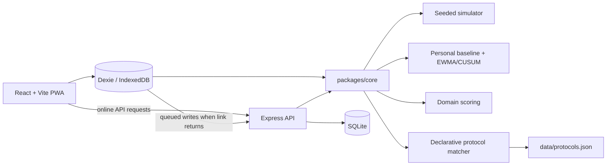
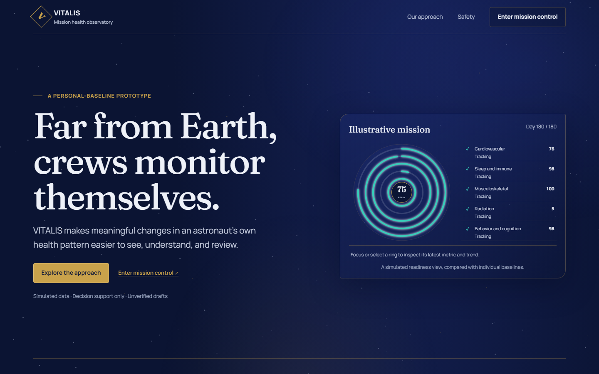
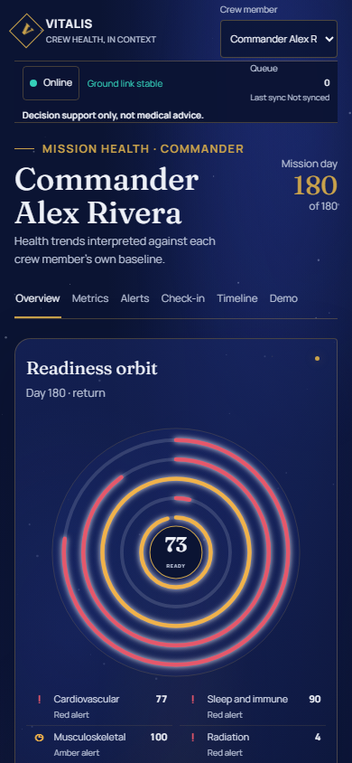
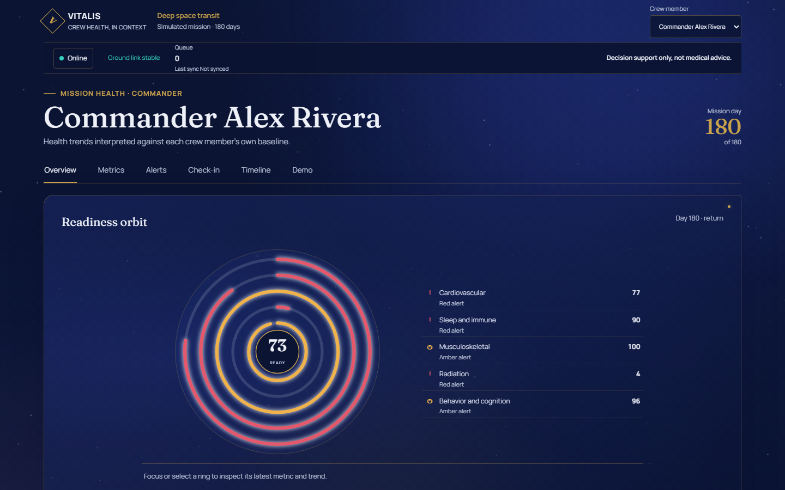
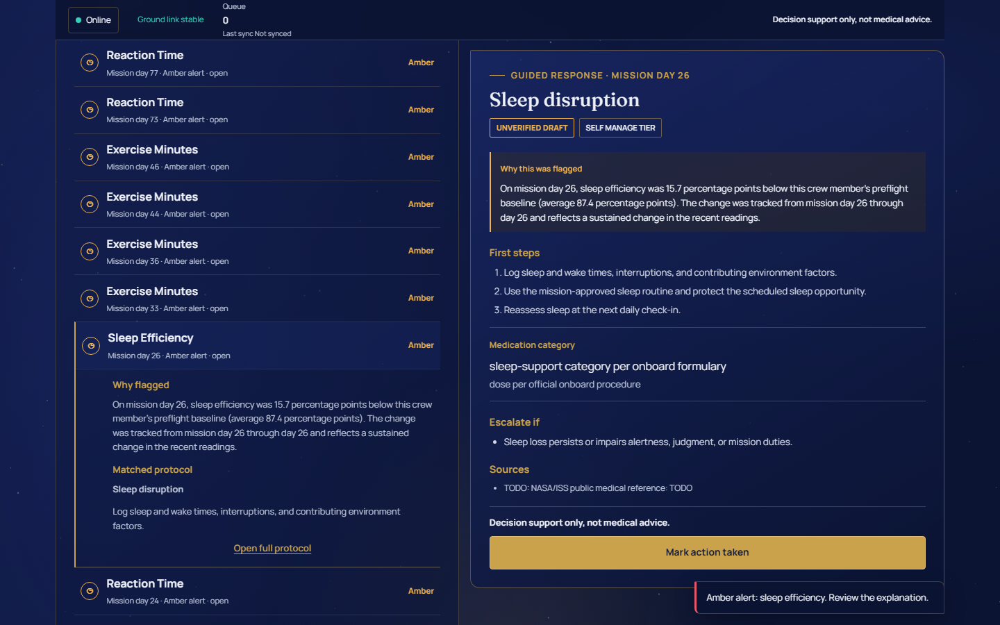
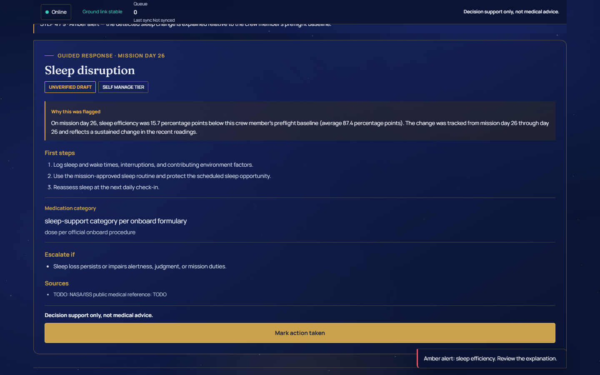
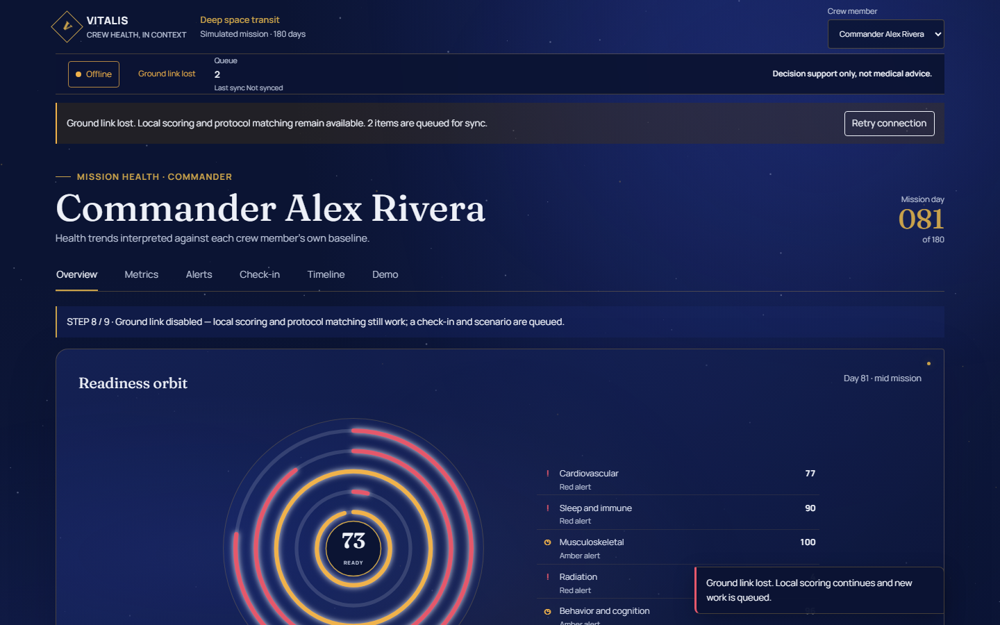

# VITALIS

VITALIS is an offline-first astronaut health monitoring and guided-response prototype for long-duration missions. Its problem is not simply finding a value outside a population range: it is making a change from a crew member's own usual pattern visible, explaining the change, and offering a clearly labeled draft response for review. The app is decision support, not diagnosis.

## What is included

- Seeded, repeatable 180-day mission simulation for four crew profiles.
- Twelve simulated metrics, four mission phases, and five injectable scenarios.
- Preflight personal baselines, EWMA z-scores, sustained red alerts, CUSUM drift detection, and five explainable domain scores.
- Seven declarative, unverified protocol drafts. Escalation-tier protocols return no medication guidance.
- SQLite-backed REST API with Zod validation, consistent errors, request logs, configurable CORS/rate limits, seed-on-boot, and idempotent offline sync.
- Responsive mission dashboard, baseline trend charts with z-scores, expandable alerts, protocol/source view, check-in, timeline, deterministic demo controls, and IndexedDB-backed offline mode.
- PWA shell caching. Health data is stored in IndexedDB, not in the service-worker HTTP cache.

## Why personal-baseline drift

Population thresholds can miss meaningful changes for an individual or over-alert on values that are usual for that person. VITALIS instead estimates a synthetic preflight baseline for each metric, then compares subsequent readings to that reference using EWMA, CUSUM, and documented illustrative amber/red thresholds. These are engineering demonstrations, not validated clinical thresholds.

## Architecture



`packages/core` is dependency-light shared TypeScript and runs in both the API and browser. Network outages do not block local simulation, scoring, protocol matching, or local check-ins. A simulated communications link can delay or queue check-ins, actions, and scenarios for delivery to `POST /api/sync`.

## At a glance

**Built for:** NASA Space Apps Challenge, "Create Health Monitoring Software for Astronauts on Space Missions".

**The idea:** On long missions the crew can't count on a ground doctor in real time, so astronauts need to spot changes in themselves. VITALIS compares each crew member to their *own* baseline, explains every flag in plain language, and offers a clearly labeled draft response. It keeps working offline.

**Try it:** [Live demo](http://localhost:5173/) ·

> Note: the free-tier API may need up to a minute to wake on first load.

### Screenshots

| Story page hero | Mission overview on mobile |
| --- | --- |
|  |  |

| Mission overview | Alerts with "why flagged" |
| --- | --- |
|  |  |

| Response protocol (unverified draft) | Offline mode and sync queue |
| --- | --- |
|  |  |


### Roadmap

- Import real wearable data through the sensor-agnostic ingestion layer
- Verified, clinician-reviewed protocols with full source citations
- Crew-to-ground sync that handles real communication delay
- Multi-crew view and mission-level readiness
- Encryption at rest and role-based access for any real-data use

### Use of AI tools

TODO: list the AI tools your team actually used (for example for code generation, research and writing) and what each was used for, following the current Space Apps guidance on AI disclosure.

## Requirements and setup

Use Node.js 24.13.0 and npm. Node `node:sqlite` is available on the pinned version, and Render's current Node runtime supports Node 24. The API therefore uses built-in `node:sqlite` on all platforms; no platform-specific database implementation is needed. Node marks this API experimental. Vercel supports Node 24.x; select **24.x** under Project Settings → Build and Deployment → Node.js Version. Vercel manages the patch release, so its build Node patch may be newer than the local/Render 24.13.0 pin.

PowerShell:

```powershell
npm ci
npm run setup:env
npm run dev
```

bash/zsh:

```sh
npm ci
npm run setup:env
npm run dev
```

Open the Vite URL printed in the terminal (normally `http://localhost:5173`). The API listens on `http://localhost:3001`. `DATABASE_PATH` must be writable and is relative to the API workspace unless absolute. `CORS_ORIGINS`, `RATE_LIMIT_WINDOW_MS`, `RATE_LIMIT_MAX`, `VITE_DEV_API_PROXY`, and `VITE_DEV_PORT` are shown in `.env.example`.

`npm run setup:env` preserves an existing `.env`. The three setup commands work in under five commands on Windows, macOS, and Linux.

Run lint, tests/build, and validate the protocol JSON Schema:

```sh
npm run lint
npm test
npm run build
npm run validate:protocols
```

Install Chromium once, then run the end-to-end judge flow and regenerate the 1440×900 screenshots:

```sh
npx playwright install chromium
npm run test:e2e
npm run screenshots
```

The browser test advances the page clock to cover the full demo sequence quickly; the interactive demo itself retains its approximately three-minute timing. `npm run smoke -- --url https://<render-service>.onrender.com` checks the deployed API endpoints; omit `--url` for the local API.

The API seeds an empty SQLite database on boot with four synthetic crew members, a 180-day mission, observations, baselines, domain scores, alerts, and protocol source rows. It reuses existing data on subsequent starts.
To explicitly initialize the database without starting the API, run `npm run seed --workspace @vitalis/api`.

## Demo

Run the fast, deterministic core demo (network-independent):

```powershell
npm run demo
```

It records a personal preflight baseline, injects sleep deprivation, shows the amber alert and matched protocol, injects blood-pressure drift, and verifies escalation-tier output has no medication guidance. It does not call the API or any external service.

For the judge-facing UI demo, choose **Enter mission control** → **Demo** → **Run demo mission**. It captions a deterministic, approximately three-minute baseline → adaptation → sleep/amber → protocol → blood-pressure/red → offline queue → restored-link sync sequence. **Reset demo** resets the selected crew member's simulated scenarios and the demo's locally queued entries. The fixed scenario days and seed are repeatable. See [docs/DEMO_SCRIPT.md](./docs/DEMO_SCRIPT.md) for captions and timing.

## API reference

All endpoints are prefixed with `/api`. Error responses use `{ "error": "...", "code": "..." }`.

| Method | Path | Purpose / inputs |
| --- | --- | --- |
| `GET` | `/health` | Liveness check. |
| `GET` | `/crew` | List synthetic crew profiles. |
| `POST` | `/crew/:id/simulate` | Rebuild mission; JSON `{ seed?, resetScenarios? }`. |
| `GET` | `/crew/:id/observations?from=&to=` | Metric observations for an inclusive day range. |
| `GET` | `/crew/:id/baseline` | Preflight baseline statistics. |
| `GET` | `/crew/:id/scores?day=` | Domain scores for a mission day. |
| `GET` | `/crew/:id/alerts?status=` | Alerts, ordered by severity then recency. |
| `PATCH` | `/alerts/:id` | Change alert status (`open`, `acknowledged`, `resolved`). |
| `GET` | `/alerts/:id/protocol` | Match and safety-filter a protocol for the alert. |
| `POST` | `/alerts/:id/actions` | Record an alert action; JSON `{ action }`. |
| `POST` | `/crew/:id/checkins` | Save a validated daily self-report. |
| `POST` | `/scenarios` | Inject a validated deterministic scenario. |
| `DELETE` | `/scenarios/:id` | Remove a scenario and rebuild the mission. |
| `GET` | `/protocols` | Return validated protocol drafts. |
| `POST` | `/sync` | Idempotently process up to 100 queued writes. |

`npm run smoke` calls the health, crew, scores, observations, alerts, protocol (when alerts exist), and protocols endpoints. Set `API_URL` to the deployed API origin; it defaults to `http://localhost:3001`.

## Assumptions

- Mission day 1 is simulator day 0; a 180-day mission therefore stores days 0-179.
- Days 0-6 form the default personal preflight baseline window. The illustrative defaults are amber at |EWMA z| ≥ 2, red at |EWMA z| ≥ 3 on two consecutive observation days, and CUSUM at 5. The core exposes overrides for experiments.
- Scores are directional prototype indicators, not clinical scores. The radiation score uses a configurable illustrative budget (default 4 mission-dose units).
- Scenario injections persist for their configured duration and affect only simulated values.
- A crew selector replaces authentication; all seeded profiles are synthetic and the prototype has no access control.
- Offline IndexedDB is the browser's local source of truth during a link outage. Server sync is idempotent by queued-write ID.
- The three-minute demo uses fixed captions and pauses; the displayed scenario days and thresholds are explanatory assumptions, not recommendations.
- No medical assumptions, source references, or citations were added during this pass. Protocol source/reviewer assignments are pending in [docs/PROTOCOL_SOURCING_CHECKLIST.md](./docs/PROTOCOL_SOURCING_CHECKLIST.md).
- The exact replacement copy promised for "At a glance" was not supplied, so the existing text was moved above setup without rewriting it; link, team, and AI-tool disclosure placeholders remain.
- The royal-observatory redesign is presentation-only: the story preview uses deterministic simulated core output, and mission scoring, API contracts, protocol data, and offline persistence remain unchanged.

## Safety and scope

- **Decision support only, not medical advice.** The system is not a diagnosis, a treatment recommendation, or a substitute for an onboard procedure or qualified clinician.
- All observations in the demo are simulated. No claim of clinical validity, flight certification, or operational readiness is made.
- All seven starter protocols are marked `verified: false` and display an **UNVERIFIED DRAFT** badge. The team must source and review every applicable field before changing a flag; the app does not infer verification.
- Medication classes are categories only and include the exact note **“dose per official onboard procedure”**. Escalation-tier protocols contain no medication category or self-treatment drug guidance.
- Do not use this prototype to make medical, flight-safety, or emergency decisions. In an emergency, follow the official onboard procedure and contact ground as available.
- The database and browser cache are prototype-grade and have no authentication, encryption-at-rest, audit controls, or regulated-data handling. Do not enter real crew health information.

## Limitations

- Node's built-in SQLite API is experimental and may change between Node releases.
- Simulated variability and thresholds are explanatory examples, not calibrated clinical thresholds.
- The PWA caches the static app shell and static assets; API responses use `Cache-Control: no-store`. Mission data is held in IndexedDB, which is not encrypted by this prototype.
- Service workers require HTTPS in deployment (localhost is allowed).
- No user authentication, role management, device integration, real telemetry, ground messaging, or clinical protocol verification is included.

## Deployment

### Vercel (web)

1. Import the repository and keep the project root at the repository root; the root `vercel.json` installs with `npm ci`, builds `@vitalis/web`, and publishes `apps/web/dist`.
2. Set `VITE_API_URL` to the Render API origin (for example `https://vitalis-api.example.onrender.com`, no trailing slash) in Vercel's build environment.
3. Deploy the web project. Vercel provides HTTPS, required for service workers.

### Render (API)

1. Choose a Render blueprint:
   - `render.yaml` uses the paid Starter plan with a persistent disk mounted at `/var/data`. SQLite data survives service restarts and deploys; persistent disks are not available on Render Free.
   - `render-free.yaml` uses a Free web service with `DATABASE_PATH=/tmp/vitalis.sqlite` and no disk. The filesystem is ephemeral, so local database writes are lost when the service spins down or redeploys. The app deterministically reseeds on every cold boot; use this only for disposable demo data.
   Both configurations use Node 24.13.0, build the API workspace, start `npm run start --workspace @vitalis/api`, and check `/api/health`. Seeding is idempotent when a database already has crew rows.
2. Set `CORS_ORIGINS` in Render to the exact deployed Vercel origin(s), comma-separated. Do not leave it blank for a public deployment. The blueprint asks for this value with `sync: false`.
3. `DATABASE_PATH=/var/data/vitalis.sqlite` and seed-on-boot are configured in the blueprint. `PORT` is supplied by Render. `RATE_LIMIT_WINDOW_MS` and `RATE_LIMIT_MAX` default to 60000 and 120.
4. Deploy the API, then set the Vercel `VITE_API_URL` build variable to its HTTPS origin and redeploy the web app.
5. After deploy, run `npm run smoke -- --url https://<render-service>.onrender.com` from PowerShell, bash, or zsh.

Deployment configuration is prepared but has not been exercised against live Vercel/Render accounts. Confirm hackathon IP and open-submission rules; [LICENSE](./LICENSE) is deliberately a placeholder.

## Release checks and remaining review

- The final local checks are `npm ci`, `npm run lint`, `npm test`, `npm run build`, `npm run validate:protocols`, `npm run test:e2e`, `npm run screenshots`, and `npm run smoke`. The smoke test requires the API to be running; a live deployment smoke test is not claimed unless its URL is provided and reachable.
- The Playwright judge-flow test covers the amber draft, escalation-tier medication restriction, offline check-in, restored-link queue drain, and duplicate-sync response. The screenshot run generates the four images linked above.
- The browser tests use the deterministic local API and Chromium; live Vercel/Render deploy behavior, Lighthouse scores, and a separate automated accessibility audit have not been verified.
- The workspace does not contain Git metadata, so a literal fresh clone and Git-based secret scan cannot be performed here. `npm ci` from the lockfile is the available clean dependency-install check; environment files and SQLite data files are ignored, and `.env.example` contains placeholders rather than credentials.
- `npm audit` reports 21 dependency advisories (7 low, 10 moderate, 2 high, 2 critical); `npm audit --omit=dev` reports one high-severity Zod advisory. Remediation includes major-version upgrades, so no force-upgrade was applied; review and resolve these advisories before production use.
- Complete all protocol sourcing/review rows before any use beyond the synthetic prototype.
