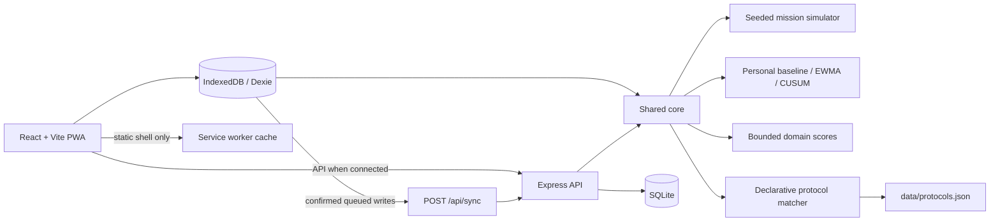

# VITALIS architecture

VITALIS is a browser PWA backed by a small Express API and a shared TypeScript core. All mission observations and protocol drafts are simulated; no real crew telemetry is collected.

## Data flow

1. On API startup, `createDatabase` applies `apps/api/src/schema.sql`, migrates the alert-related-metrics column when needed, validates protocol drafts, and seeds an empty database.
2. `packages/core` generates deterministic observations from the crew ID, seed, mission day, and scenario inputs. The API persists the result; the browser can run the same engine locally.
3. Seven preflight observations establish each metric baseline. EWMA and CUSUM detect drift; a red alert requires the red threshold on consecutive observation days. Same-day alerts in one domain are merged and retain their related metric identifiers.
4. The UI caches mission snapshots in IndexedDB. Its service worker caches the static shell/assets only; API responses use `Cache-Control: no-store`.
5. Offline check-ins, actions, and scenarios are persisted in the local queue. `POST /api/sync` uses the queue item ID as its idempotency key. The client marks a record processed only after every submitted ID is confirmed.

## Trust and deployment boundaries

- The API validates request bodies, path values, and query values with Zod; database values are passed as SQL parameters.
- CORS and in-memory per-client rate limits are configured with `CORS_ORIGINS`, `RATE_LIMIT_WINDOW_MS`, and `RATE_LIMIT_MAX`.
- SQLite is suitable for the single-instance prototype. The in-memory limiter and SQLite file are not a horizontally scaled production architecture.
- Authentication, encryption at rest, regulated-data controls, device integrations, and remote clinical oversight are out of scope.
- Protocol `verified` flags remain false until a qualified reviewer verifies the cited source title/URL and approves each supported field.
